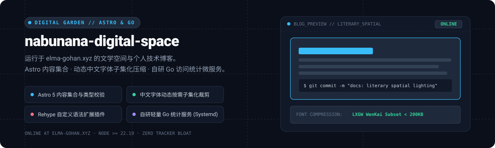

# blog · nabunana-digital-space

<div align="center">
  
</div>

<p align="center">
  <a href="https://elma-gohan.xyz"><strong>在线访问 (elma-gohan.xyz)</strong></a> ·
  <a href="#核心工程特性"><strong>核心特性</strong></a> ·
  <a href="#本地开发与常用命令"><strong>常用命令</strong></a> ·
  <a href="#目录结构"><strong>目录划分</strong></a> ·
  <a href="#生产发布与部署"><strong>部署发布</strong></a>
</p>

---

本项目是基于 [Astro](https://astro.build) 现代前端框架构建的个人数字空间与技术博客，线上域名托管于 [elma-gohan.xyz](https://elma-gohan.xyz)。

系统融合了文学感排版规范与扎实的工程化基础设施，致力于在保障静态极致加载性能的同时，提供舒适沉浸的阅读体验。

---

## 核心工程特性

### 1. Markdown 渲染扩展管线
基于 `@astrojs/markdown-remark` 深度定制：
- 启用 Rehype 标题自动生成语义化锚点（`rehype-slug` 与 `rehype-autolink-headings`）；
- 自研代码块增强插件：实现一键复制代码片段、文章系列连载导航卡片与关联 GitHub 仓库卡片渲染。

### 2. 动态中文字体子集化裁剪
针对中文 Web 字体体积过大（常见几 MB 至十几 MB）导致的初屏加载阻塞痛点，项目开发了动态裁剪工作流（`scripts/subset-fonts.mjs`）：
在构建阶段自动扫描提取全站文章与页面的实际用字集合，将霞鹜文楷等字体精确子集化为微型体积的 WOFF2 格式，显著降低网络加载开销。

### 3. 内容集合与强类型校验
全站文章集中管理于 `src/content` 目录，通过 Astro Content Collections 规范统一组织；在 `src/content.config.ts` 中基于 Zod 定义文章元数据（Frontmatter）的强类型校验，杜绝发布格式缺失或日期错误。

### 4. 自研 Go 轻量访问统计微服务
拒绝笨重或侵犯隐私的第三方商用统计脚本。在 `stats/` 目录下内置基于 Go 语言编写的轻量访问统计守护进程，搭配 SQLite 存储与 systemd 部署服务脚本（`scripts/install-stats-service.sh`），实现私有化、零 Cookie 追踪的极简 PV / UV 记录。

### 5. 完备的工程化防线
- **静态资源合规性 CI**：通过 `scripts/check-content-assets.mjs` 校验封面与配图；
- **自动化验收测试**：`tests/` 目录下配套基于 Python 的全链路验收测试；
- **依赖自愈更新**：配置 Dependabot 保持前端依赖生态长期安全与更新。

---

## 本地开发与常用命令

运行环境要求：Node.js $\ge 22.19.0$。

```bash
npm run dev      # 启动本地开发热重载服务
npm run fonts    # 手动触发中文字体子集化裁剪
npm run build    # 执行字体裁剪 + astro check 检查 + 生产构建
npm run preview  # 本地启动静态产物预览
```

---

## 目录结构

```text
blog/
├── src/          # 页面路由、UI 组件、Base 布局、全局样式与 Content Collections
├── public/       # 静态资源（多媒体、子集化字体、Favicon、社交分享 OG 图）
├── scripts/      # 字体裁剪、CI 资源检查、发布部署与验收自动化脚本
├── stats/        # Go 语言编写的轻量访问统计独立微服务
├── tests/        # Python 编写的页面与接口端到端验收测试
├── docs/         # 验收检查清单与运维流程说明
├── DESIGN_LANGUAGE.md / MOTION_DESIGN.md   # 文学空间设计系统与动效规范指南
├── OPERATIONS.md / WORKFLOW.md / HANDOFF.md # 生产运维 SOP 与协作交付规范
└── assets/readme/ # 包含项目原生数字空间矢量图 (hero.svg)
```

---

## 生产发布与部署

生产环境的构建与发布由自动化脚本承载：
- 静态网站部署：运行 `scripts/deploy-release.sh`；
- 统计服务部署：运行 `scripts/deploy-stats-release.sh`。

详细的运维配置、Nginx 反代规则与 systemd 守护配置参见 [`OPERATIONS.md`](OPERATIONS.md)。
